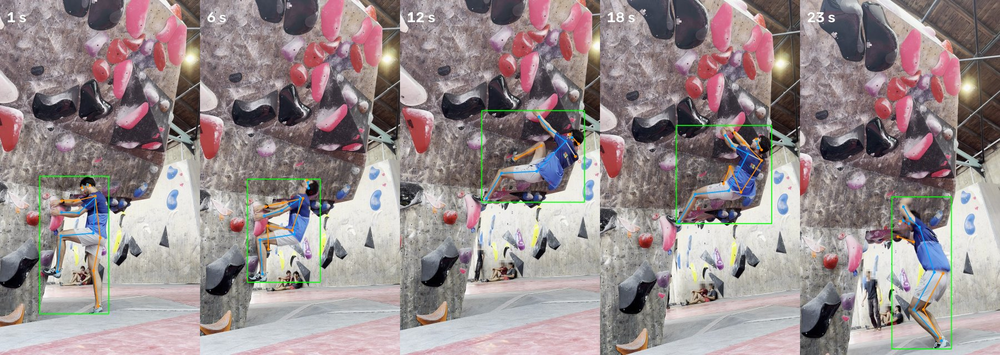
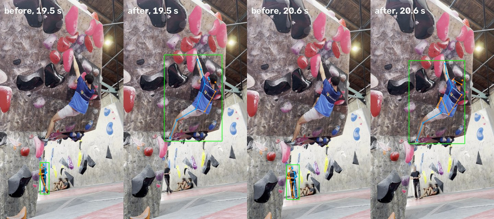

Every climber knows the feeling: you fall off a boulder problem, someone else
walks up and makes it look easy, and you can't tell what they did differently.
**ClimbVLA** is my side project to answer that from a phone video. You film your
climb, and it shows you, move by move, how it compares with a reference climb on
the same route, summed up as a "Beta Score" (in climbing, the *beta* is the way
to do a route).

This first post covers the beginning: deciding what the data looks like, then
getting from a video to the climber's skeleton on every frame. Along the way
there was one bug worth telling and one moment where I had to step back and
change the plan. No machine learning background is needed to follow it.

## The big picture

Here is the whole pipeline. The solid boxes are what this post builds; the
dashed ones come next.

<figure>
<svg viewBox="0 0 750 275" role="img" aria-label="ClimbVLA pipeline. Built in this post: phone video, frames with timestamps, person box with RT-DETR, skeleton with ViTPose, pose file, and clicked holds. Next: contacts, moves, metrics, Beta Score." style="width:100%;height:auto;font-family:Inter,system-ui,sans-serif">
  <defs>
    <marker id="climb-arrow" viewBox="0 0 8 8" refX="7" refY="4" markerWidth="7" markerHeight="7" orient="auto">
      <path d="M0,0 L8,4 L0,8 z" style="fill:var(--muted)"/>
    </marker>
  </defs>
  <g style="fill:var(--surface);stroke:var(--accent);stroke-width:2">
    <rect x="5" y="30" width="130" height="64" rx="10"/>
    <rect x="157" y="30" width="130" height="64" rx="10"/>
    <rect x="309" y="30" width="130" height="64" rx="10"/>
    <rect x="461" y="30" width="130" height="64" rx="10"/>
    <rect x="613" y="30" width="130" height="64" rx="10"/>
    <rect x="5" y="170" width="130" height="64" rx="10"/>
  </g>
  <g style="fill:var(--surface);stroke:var(--muted);stroke-width:1.5;stroke-dasharray:6 5">
    <rect x="157" y="170" width="130" height="64" rx="10"/>
    <rect x="309" y="170" width="130" height="64" rx="10"/>
    <rect x="461" y="170" width="130" height="64" rx="10"/>
    <rect x="613" y="170" width="130" height="64" rx="10"/>
  </g>
  <g style="stroke:var(--muted);stroke-width:1.5;fill:none" marker-end="url(#climb-arrow)">
    <line x1="135" y1="62" x2="155" y2="62" marker-end="url(#climb-arrow)"/>
    <line x1="287" y1="62" x2="307" y2="62" marker-end="url(#climb-arrow)"/>
    <line x1="439" y1="62" x2="459" y2="62" marker-end="url(#climb-arrow)"/>
    <line x1="591" y1="62" x2="611" y2="62" marker-end="url(#climb-arrow)"/>
    <polyline points="678,94 678,132 222,132 222,168" marker-end="url(#climb-arrow)"/>
    <line x1="135" y1="202" x2="155" y2="202" marker-end="url(#climb-arrow)"/>
    <line x1="287" y1="202" x2="307" y2="202" marker-end="url(#climb-arrow)"/>
    <line x1="439" y1="202" x2="459" y2="202" marker-end="url(#climb-arrow)"/>
    <line x1="591" y1="202" x2="611" y2="202" marker-end="url(#climb-arrow)"/>
  </g>
  <g style="fill:var(--text);font-size:14px;font-weight:600" text-anchor="middle">
    <text x="70" y="58">Phone video</text>
    <text x="222" y="58">Frames</text>
    <text x="374" y="58">Person box</text>
    <text x="526" y="58">Skeleton</text>
    <text x="678" y="58">Pose file</text>
    <text x="70" y="198">Clicked holds</text>
    <text x="222" y="198">Contacts</text>
    <text x="374" y="198">Moves</text>
    <text x="526" y="198">Metrics</text>
    <text x="678" y="198">Beta Score</text>
  </g>
  <g style="fill:var(--muted);font-size:12px" text-anchor="middle">
    <text x="70" y="77">24 s, 30 fps</text>
    <text x="222" y="77">+ timestamps</text>
    <text x="374" y="77">RT-DETR</text>
    <text x="526" y="77">ViTPose</text>
    <text x="678" y="77">saved once</text>
    <text x="70" y="217">in pixels</text>
    <text x="222" y="217">hand on hold?</text>
    <text x="374" y="217">hold to hold</text>
    <text x="526" y="217">technique</text>
    <text x="678" y="217">vs. a reference</text>
    <text x="375" y="262">solid = built in this post · dashed = next</text>
  </g>
</svg>
<figcaption>The pipeline. The skeleton and the clicked holds meet at "Contacts": which hand or foot is on which hold, and when.</figcaption>
</figure>

## Step 1: agree on the data before writing any logic

The project has many stages: tracking the climber, finding the holds, planning
a route in a simulator, scoring. They all need to talk to each other. So before
any computer vision, I wrote down **what the data looks like**: a hold, a
route, a body pose at one instant, a contact ("right hand on hold h3 from 2.0 s
to 4.5 s"), a move, a whole climb, and the final report.

I used [Pydantic](https://docs.pydantic.dev/), a Python library where you
describe data as a class and it checks every value for you:

```python
class Hold(BaseModel):
    model_config = ConfigDict(extra="forbid")  # unknown fields are errors

    id: str
    x: float  # meters from the left edge of the wall
    y: float  # meters above the bottom
    radius: float = Field(gt=0, le=1.0)  # meters, above 0 and at most 1
```

If a file says `"raduis": 0.1` (a typo), or a radius of 5 meters, loading it
fails immediately with a clear message instead of quietly producing wrong
results three stages later. Writing these rules early felt slow, but it is the
cheapest moment to do it: changing a data format is easy when nothing uses it
yet, and painful once ten files depend on it.

Most of the interesting work in this step was **questions about climbing**
that the format had to answer:

- **What if the climber is seen from behind?** Pose models always return all
  17 body points, even the face of someone facing the wall. They just give the
  hidden ones a low *confidence* (how sure the model is, from 0 to 1). So every
  pose keeps all 17 points, and one shared rule decides what counts as
  visible: confidence of at least 0.5.
- **Which body parts touch holds?** Hands and feet, obviously. I added
  **knees**, because climbers use knee bars and drop-knees. I decided against
  elbows and shoulders: they are often *near* holds without being *on* them,
  so they would create false contacts.
- **What about smearing?** A *smear* is pressing your foot flat on the wall
  where there is no hold. So a limb's target can be one of three things: a
  hold, a point on the wall, or the ground.
- **Store each fact once.** A move records where a limb went from and to. It
  does not also store which other limbs were holding on at the time, because
  that can be computed from the contacts. Two copies of the same fact
  eventually disagree.

### The first change of design: what is a "reference"?

My first version assumed a climb is always compared with a *simulated*
reference climber. Then I asked myself: will there always be one? Often not,
for a new route. And the comparison people actually want is often with **a
friend who did the route**, or with **their own earlier attempt**.

So I changed the format: a climb records whether it came from a video or a
simulation, *any* climb can be the reference for another, and a report can be
made with no reference at all (then it only describes your climb, with no
score). A small change in the format, but it widened what the project can do.

## Step 2.1: reading a video, frame by frame

A video is a series of still images (*frames*), here 30 per second. Two details
mattered:

- **Each frame's time comes from the video file**, not from "frame number ÷ 30".
  Phones often record at a slightly variable frame rate, so the simple formula
  drifts over a long climb.
- **Frames are read in order from the start**, rather than jumping straight to a
  given second. Video files are compressed, and a jump lands on the nearest
  *keyframe* (a complete image), not on the exact frame you asked for.

## Step 2.2: finding the skeleton in one image

*Pose estimation* means finding a person's body points (shoulders, elbows,
wrists, hips, knees, ankles, plus nose, eyes and ears: 17 in total) in an
image. I used two ready-made models from
[Hugging Face](https://huggingface.co/docs/transformers/model_doc/vitpose), in
two stages:

1. **A person detector, RT-DETR**, draws a box around every person in the image.
   The climber is the most confident one (this rule comes back later).
2. **ViTPose** looks inside the climber's box and finds the 17 points.

Both run on the laptop's GPU, at about 0.2 seconds per frame.

<figure>
  
  <figcaption>The box (green) and the skeleton on five moments of the climb. Left side blue, right side orange, so a left/right mix-up is easy to spot. Faces of people in the background are blurred.</figcaption>
</figure>

A few small surprises, each now covered by a test:

- **Color order.** OpenCV, the library that reads the video, stores colors as
  blue-green-red. The models expect red-green-blue. Forgetting to convert
  doesn't crash anything; the results just get quietly worse.
- **A "confidence" of 1.01.** ViTPose's scores aren't true probabilities and
  can go slightly above 1, which my data format rejects. They are now clipped
  to 1.
- **Point order.** The model returns 17 points as a plain list, and only their
  order says which one is the left wrist. The code checks that order when the
  model loads, so a different model can't silently swap left and right.

## Step 2.3: the whole video, saved once

At 0.2 seconds per frame, Robert's 24-second climb (720 frames) takes about
two minutes. Every later step needs the pose, and nobody wants to wait two
minutes each time. So the tracking runs **once** and saves the result to a file
(160 KB), which every later step reads in a fraction of a second.

Two choices in that file:

- **Arrays, not lists of objects.** The pose is stored as a table of numbers,
  one row per frame. Later steps work *along time* (for example smoothing the
  path of the left wrist), and that's one line on such a table.
- **Frames where nobody was found are kept**, filled with *NaN* ("not a
  number", the standard marker for a missing value). That way row 100 is
  always frame 100, and the timing stays regular.

The tests don't load any model: they hand the tracking code a **fake
estimator** that returns made-up poses. All the logic is tested in about 3
seconds instead of a minute.

## The bug: tracking the wrong person

The first full run reported: *person found on 100% of frames*. That sounded
perfect. Then I looked at the frames where the box jumped around:

<figure>
  
  <figcaption>"Before": the skeleton lands on someone standing on the floor. "After": it stays on the climber.</figcaption>
</figure>

After 19.5 seconds, while Robert hangs almost upside down under the overhang,
the detector became **more confident about a person standing on the floor**
than about him. My rule, "the climber is the most confident person", picked the
bystander on 12 frames. The pose was found on 100% of frames, but not always
the right person's pose.

The fix uses a simple idea: **between two frames, the climber barely moves**. So
instead of taking the most confident person, take the person whose box
**overlaps most** with the climber's box in the previous frame. Overlap is
measured with *IoU* (intersection over union): the shared area of two boxes
divided by the total area they cover. It is 1 for identical boxes and 0 for
boxes that don't touch.

```python
def box_overlap(a, b):
    """Intersection over union: 1 for the same box, 0 for boxes that don't touch."""
    shared_w = max(0, min(a.x + a.w, b.x + b.w) - max(a.x, b.x))
    shared_h = max(0, min(a.y + a.h, b.y + b.h) - max(a.y, b.y))
    shared = shared_w * shared_h
    return shared / (a.w * a.h + b.w * b.h - shared)
```

If nobody overlaps the previous box, the frame gets no pose at all: **no answer
is better than the wrong person's answer**. After the fix, no frame picks the
bystander and no frame is lost.

## Step 2.4: an overlay video to check by eye

To trust numbers, you need to *see* them. This tool draws the saved skeleton on
every frame and writes a new video, in about 13 seconds since the models don't
run again. Points the model isn't sure about are drawn as small red circles.

<video src="/assets/posts/climbvla-part-1/overlay.mp4" poster="/assets/posts/climbvla-part-1/overlay-poster.jpg" controls muted playsinline loop></video>

Watching it was the checkpoint for the riskiest assumption of the whole
project: **is the pose good enough to tell which hold a hand is on?** On this
video, yes. The climber's left side, facing the camera, is seen on nearly
every frame (left wrist 100%, left ankle 98%). The right side, facing away, is
seen less often (right wrist 62%, right ankle 74%). Those gaps are short, and a
later step fills them in.

## The step back: the camera angle

The original plan assumed a phone on a tripod, **facing a flat wall**. Then one
scale ("this many pixels is one meter", taken from the climber's height) turns
the image into real wall coordinates.

Robert's video is nothing like that. It is filmed from below and to the side,
on an overhang made of several wall panels at different angles. In that view,
no single scale is right: a meter close to the camera covers many more pixels
than a meter far away. And honestly, most climbing videos people film in a gym
look like this one, not like my plan.

I considered three options:

| Option | What it means | Verdict |
|---|---|---|
| Film frontal videos | Keep the plan, change the videos | Avoids the problem instead of solving it |
| **Work in pixels** | Detect contacts in the image itself | **Chosen**: works at any camera angle |
| Convert each wall panel to meters | Needs each panel's real size | Panel sizes are rarely known |

The key realization: **deciding which hold a hand is on doesn't need meters at
all.** If the camera doesn't move, a hold stays at the same place in every
frame, and "is the hand on the hold?" can be answered in the image. Distances
are measured relative to the climber's body (for example "within half a
forearm"), so they work whether the climber is near or far from the camera.
Meters are only needed later, for technique metrics and for comparing two
different videos.

The trade-off is known and written down: from the side, a hand can be *in
front of* a hold in the image without touching it. Requiring the hand to also
be still catches most of those cases. A later step will measure how often it
goes wrong.

## Step 2.6: clicking the holds

Automatic hold detection is a later step. For now, a small tool shows one frame
of the video: you drag from each hold's center to its edge, then click the
start holds, then the top hold. It saves the route **in pixels, for that
video**. That's a separate file from the route in meters, because the same
route filmed twice gives two different sets of pixel positions.

## What I learned

1. **Design the data first.** Most real decisions in step 1 were about
   climbing, not code: knees yes, elbows no, smears as wall points, a reference
   that doesn't have to exist.
2. **"100% found" is not "100% right".** The summary number looked perfect,
   while the drawn images were not. Draw your results, and look at them.
3. **Make expensive steps run once.** Saving the pose turned a two-minute wait
   into a fraction of a second for every later step.
4. **Test without the expensive parts.** A fake estimator tests all the logic in
   seconds; the real models get one slow test of their own.
5. **Check the plan against real data early.** The camera-angle problem showed
   up on the first real video. Finding it now cost a design change; finding it
   after building on meters would have cost a rewrite.

## What's next

Clicking the holds on Robert's video, then the part the whole project is
about: detecting **contacts** (which limb is on which hold, and when), then
turning them into **moves**. That's for part 2.

The code is on [GitHub](https://github.com/RomaneCastel/ClimbVLA).
