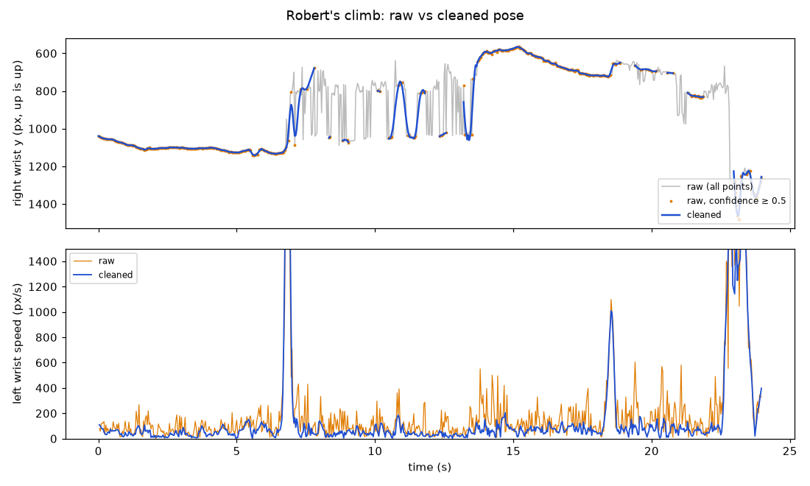
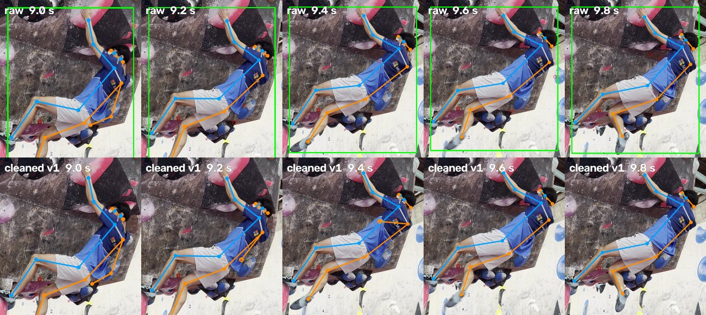
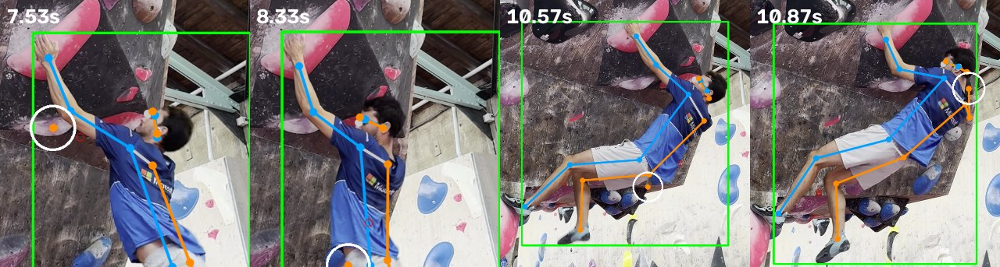
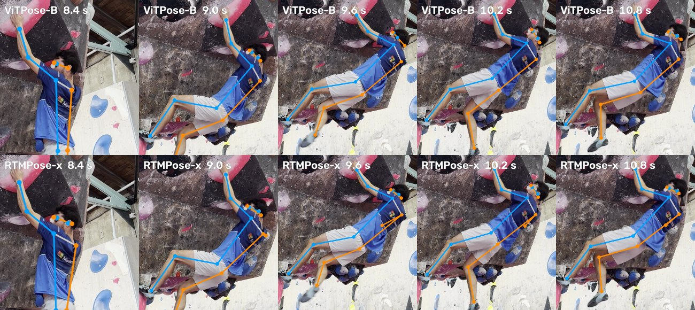

In [part 1](/posts/climbvla-part-1-from-video-to-skeleton/), I got from a phone
video to the climber's skeleton on every frame. The next goal is the heart of
the project: telling **which hand or foot is on which hold, and when**. A hand
is on a hold when it is *near* it and *still*.

This post is about the "still" part. It turned out to be harder than it looks,
and it ended with a measurement I should have made earlier. As in part 1, no
machine learning background is needed.

## Why a skeleton needs cleaning

The pose model gives 17 points per frame, 30 frames per second. Three things
make that raw output bad at saying whether a hand is still:

- **Some points are guesses.** Each point comes with a *confidence*, from 0 to
  1. Below 0.5, the model is mostly guessing, for example a hand hidden behind
  the body.
- **Points jitter.** Even a hand gripping a hold moves a few pixels from one
  frame to the next. A speed is a difference between frames, so a 3-pixel
  jitter at 30 frames per second already looks like 90 pixels per second of
  movement. A still hand doesn't look still.
- **Left and right sometimes swap**, for a frame or two.

So I wrote a cleaning step, with each rule chosen from the data rather than
guessed:

1. **Hide the guesses.** Points under 0.5 confidence become *unknown* (`NaN`,
   "not a number", the standard marker for a missing value). Unknown is better
   than wrong: a later step can handle "I don't know", but it can't tell a wrong
   position from a right one.
2. **Fix left/right swaps**, before anything else, so no later step blends the
   left wrist with the right one.
3. **Fill short gaps** with a straight line, if they last 0.3 seconds or less.
   Why 0.3? I measured first: on Robert's climb, 35 of the right wrist's 44
   gaps are that short. A hand can make a whole move in about half a second,
   so longer gaps stay unknown.
4. **Smooth** with a *Savitzky–Golay filter*: it slides a short window along
   time and fits a small curve to the points in it. Unlike a plain average, it
   keeps the shape of quick moves while removing the jitter.

One test caught a bug that every programmer meets once: a 0.3-second gap,
computed as 0.4 − 0.1, wasn't filled. In a computer, 0.4 − 0.1 is
0.30000000000000004, just over the limit. The fix is to compare times with a
tiny tolerance, never exactly.

<figure>
  
  <figcaption>Bottom: cleaning calms the jitter (the left wrist's typical speed drops from 100 to 58 pixels per second). Top: between 7 and 13 s, something else is going on with the right wrist.</figcaption>
</figure>

## My numbers said smoother

I measured the result on every joint: about 4 times less frame-to-frame
acceleration, fewer points appearing and disappearing, smaller jumps. By every
number, the cleaned skeleton was smoother.

Then I watched the cleaned video, and it looked **worse**.

<figure>
  
  <figcaption>The same second of climbing. Top: the raw skeleton leaves out the doubtful right arm. Bottom: my first cleaning draws it, sweeping across his chest.</figcaption>
</figure>

Between 7 and 13 seconds, Robert's right arm is hidden behind his body. The
model still "saw" his right wrist now and then, for one to five frames at a
time, alternating between two places about 300 pixels apart. To really do that,
a hand would have to move six to thirteen times the length of his torso per
second. My cleaning trusted those points: gap filling drew lines between the
right and the wrong positions, and smoothing spread each wrong point over a
third of a second.

Two new rules fixed what the video showed, both measured in *body units*
(torso lengths) rather than pixels, so they work whether the climber is near
the camera or far from it:

- a point seen for only one or two frames in a row is a guess;
- a gap isn't filled if crossing it would mean moving faster than 3 torso
  lengths per second (about 1.5 m/s).

## "Bones don't stretch"

But the real problem wasn't the cleaning. It was the pose model guessing
positions for limbs it couldn't see, sometimes **with confidence**.

<figure>
  
  <figcaption>Confident is not correct: the hidden right wrist placed on the knee at 8.33 s (confidence 0.64) and near the hip at 10.57 s.</figcaption>
</figure>

My first idea for catching these was physics: a leg or an arm doesn't change
length. If the "wrist" is farther from the shoulder than an arm can reach, it
must be wrong.

It caught almost nothing: one frame out of about 400. Two reasons, and both are
good to know about images:

- **A flat image only shows bones shorter, never longer.** An arm pointing at
  the camera looks short. So the rule can only catch limbs that look too long,
  and a wrist placed on the knee is well within arm's reach of the shoulder.
- **Perspective.** When Robert drops off the wall toward the camera, his whole
  body gets bigger in pixels. My first version used one fixed bone length and
  flagged those correct frames as wrong. Scaling every frame by its own torso
  length fixed that, but not the first problem.

Bone length really is constant in 3D, which is why 3D pose models can use it.
In 2D it's a weak rule.

## Measuring instead of guessing

At that point I'd been judging the pose model by eye. In part 1, its checkpoint
was me watching the video and saying "looks good". So I added a step to the
plan: **measure it**.

- **Labels.** I wrote a small tool that shows one frame every half second,
  zoomed on the climber, and I clicked where his wrists and ankles really were:
  46 frames, 184 points. The model's skeleton is hidden while clicking, so it
  can't influence where I click. These clicks are the *ground truth*.
- **Three models, same box.** The current one (ViTPose-B), its much bigger
  sibling (ViTPose+ Huge, about 7 times larger), and a model from another family
  (RTMPose-x). All three get the same box around the climber, so only the part
  that finds the joints is compared.
- **A score.** *PCK* (percentage of correct keypoints) is the share of points
  within a set distance of the clicked one. Here the distance is 0.2 torso
  lengths, about 43 pixels.

| Model | All points correct | Right wrist correct | Right wrist while hidden (7–13.5 s) | Wrong points with confidence ≥ 0.5 |
|---|---|---|---|---|
| ViTPose-B (before) | 87% | 57% | 0 of 13 | 6 |
| ViTPose+ Huge | 94% | 80% | 7 of 13 | 4 |
| RTMPose-x | 95% | 80% | 4 of 13 | **0** |

The left wrist and ankle, facing the camera, were right 100% of the time for
all three. The difference is all on the hidden side.

The surprise is in the last column. Huge finds the hidden wrist more often, but
RTMPose-x is the only one that **knows when it's wrong**: all nine of its misses
on the hidden wrist had a confidence below 0.5. With the 0.5 threshold, its
mistakes become *unknown* instead of *wrong*, which is exactly what deciding
"is this hand on a hold?" needs. It is also 3 times faster than Huge. So the
project now uses RTMPose-x.

<figure>
  
  <figcaption>Both after cleaning. Top: the old model. Bottom: RTMPose-x keeps the right leg in a sensible place.</figcaption>
</figure>

Running it on the whole climb, the right ankle went from seen on 74% of frames
to 92%, and the flickering guesses on the hidden wrist dropped from 21 bursts
to 5.

The honest limits: this is one video, one climber and one person clicking.
94% versus 95% is a difference of one or two points, which is noise. The
hidden-wrist and confident-but-wrong differences are the real ones.

## What I learned

1. **Look at the pictures, not only the numbers.** The cleaning was smoother by
   every measure and worse on screen. The problem was in the inputs, not the
   cleaning.
2. **Unknown is better than wrong.** Filling and smoothing assume their inputs
   are right; feed them a confident mistake and they spread it.
3. **An idea can be right and still weak.** Bones don't stretch, but a flat
   image only shows them shorter.
4. **"Looks good" is not a measurement.** 46 labeled frames took one evening
   and changed which model the project uses.
5. **Pick the model that knows when it's wrong.** For this project, a model's
   confidence matters as much as its accuracy.

## What's next

With a skeleton I can now trust (or that says when I can't), the next step is
the one the whole project is built around: detecting when each hand and foot
is on a hold.

The code is on [GitHub](https://github.com/RomaneCastel/ClimbVLA).
