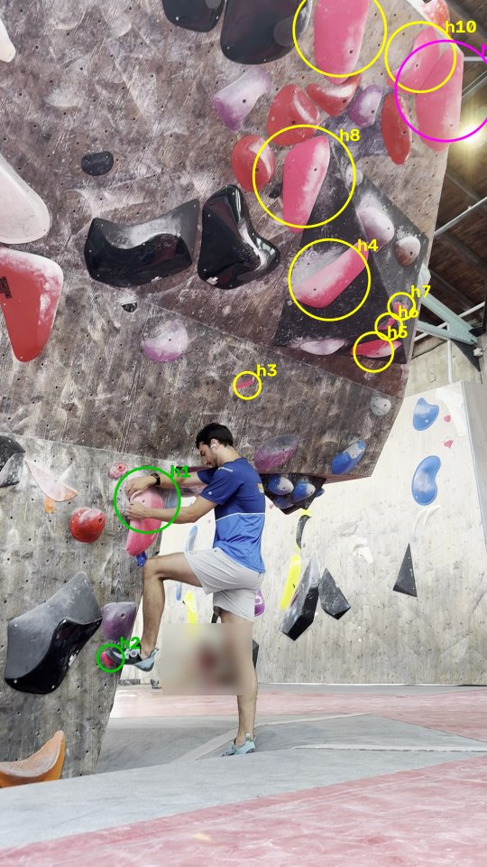
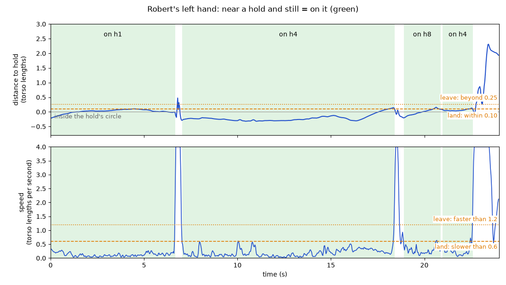
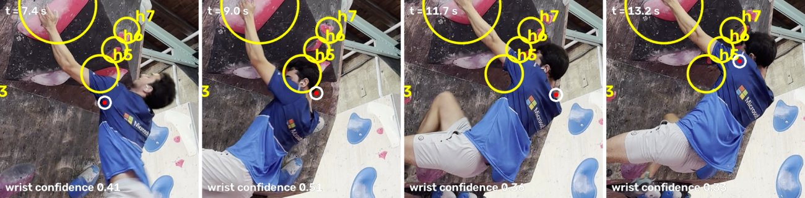
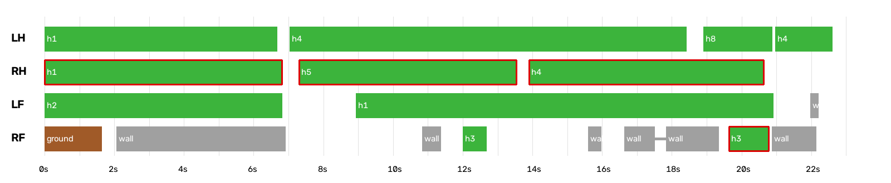
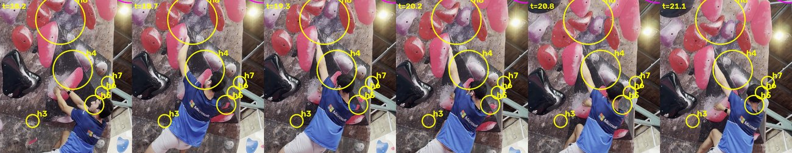

In [part 2](/posts/climbvla-part-2-smoother-numbers-worse-eyes/), I ended with
a skeleton I could trust, or one that says "I don't know" when I can't. This
post is about the question the whole project is built around: **which hand or
foot is on which hold, and when?**

Any climber answers that at a glance. A computer has two problems first: it
doesn't know where the holds are, and it doesn't know what "on" means. As in
the earlier parts, no machine learning background is needed.

## Telling the computer where the holds are

Finding holds automatically is a later step of the project (it needs its own
model). For now, I click them. I wrote a small tool that shows one frame of the
video: I drag from each hold's center to its edge, then pick the start holds
and the top. On Robert's climb, that's 11 holds, `h1` to `h11`.

<figure>
  
  <figcaption>Eleven holds clicked by hand. Green: start holds, magenta: top. The start holds are exactly where the climber's hands and feet are.</figcaption>
</figure>

The holds are stored **in pixels, per video**, not in meters on the wall. The
video was filmed from below and to the side, on an overhang made of several
panels, so a single "pixels to meters" scale doesn't exist (part 1 tells that
story). The cost: the same route filmed from another spot needs its holds
clicked again.

The first real use showed something no test had: the start of a climb is the
worst moment to see the start holds. The climber is standing on them.

## "Near and still", as numbers

My definition of a contact: **a hand is on a hold when it's close to it, nearly
still, for long enough.** Each word needs a number, and I measured before
choosing any.

- **Units.** Pixels change with the distance to the camera, so distances are in
  *torso lengths* (shoulders to hips, 225 pixels in this video), and speeds in
  torso lengths per second.
- **Still.** A hand gripping a hold moved at 0.05 to 0.6 torso lengths per
  second (the wrist turns as the body moves). During a move: 1.9 to 8.
- **Where the hand is.** The pose model gives wrists, not fingers. So the
  "hand point" is pushed a bit past the wrist, along the forearm. With that,
  Robert's left hand on `h4` sat well inside the hold's circle.
- **Feet are worse.** The model gives ankles, not toes, and the toes are what
  touch the hold, about 0.4 torso lengths away in a direction the skeleton
  doesn't show. The left ankle on `h2` sat up to 0.36 torso lengths *outside*
  the circle. Feet get wider margins.

Then the trick that makes it work: **two thresholds instead of one**, called
*hysteresis*. It's how a thermostat works: heating on below 19 °C, off above
21 °C, so it doesn't click on and off at 20 °C. Here a hand *lands* when it's
within 0.10 torso lengths of the hold's circle and slower than 0.6; it *stays*
until it's beyond 0.25 or faster than 1.2. A hand resting at the edge of a hold
jitters a little; with one threshold, every jitter would end the contact and
start a new one, and each would look like a move.

<figure>
  
  <figcaption>Robert's left hand. Green: detected contacts. Dashed lines: the thresholds to land; dotted lines: the looser ones to leave. The speed spikes are the moves.</figcaption>
</figure>

One of my tests was named "jitter at the edge doesn't end the contact", and it
passed. A review found it passed for the wrong reason: the jitter I'd made up
was so fast that the contact ended at its start, and the test only counted
contacts. I rewrote it to check *when* the contact ends. With two thresholds,
3.0 seconds, as it should. With one, 0.97 seconds. A test should check the
thing it's named after.

Hands can only be on holds. Feet can also be on the **ground** (as low as the
lowest foot at the start) or on the **wall**: a still foot away from the
route's holds, for smears. On Robert's climb, "wall" also catches holds of
other routes. Good climbers use whatever is there.

## The hand the model saw but didn't believe

The first version found 18 contacts. Then I watched the video with the
contacts drawn on it, and saw something the numbers hadn't shown: from about 7
to 13 seconds, Robert's right hand is on `h5`, and the detector said nothing.

The hand wasn't hidden. My hand-made labels from part 2 put the right wrist
next to `h5` on all 14 labeled frames of that stretch. The pose model had put
it there too, but unsure: confidence 0.34 on a typical frame, 0.5 or more on
only 5% of them. And the
cleaning step from part 2 hides every point under 0.5. The contact detector
never saw the hand.

<figure>
  
  <figcaption>The white ring is where the model put the right wrist: near <code>h5</code> every time, but almost never with a confidence of 0.5 or more (5% of the frames).</figcaption>
</figure>

The obvious fix is a lower threshold. I checked it against the labels first
("right" means within 0.2 torso lengths of my click, out of 184 wrist and
ankle points):

| Threshold | Right points kept | Wrong points kept |
|---|---|---|
| 0.5 (now) | 171 | **0** |
| 0.4 | 174 | 2 |
| 0.3 | 178 | 6 |
| 0.2 | 178 | 11 |

Part 2 chose its pose model *because* it had zero confident mistakes. Lowering
the threshold everywhere would undo that.

The idea that worked: **one unsure point is noise, but many unsure points in the
same place are evidence.** A hand on a hold doesn't move, so its uncertain
positions pile up around the hold. A wrong guess, as part 2 showed, jumps
around. So where the confident point is missing, contact detection takes the
*median* of the low-confidence points over half a second. A median ignores a
few points far from the rest. This weaker evidence is only allowed to say
"on a hold", never "on the wall" or "on the ground", and the cleaned skeleton
itself doesn't change: "which hold?" is a rougher question than "where
exactly?", so it can use rougher evidence.

It took two failures to get there:

1. **I pushed the weak point toward the fingers**, as for confident points. The
   elbow was just as unsure as the wrist, so the push went the wrong way, and
   the hand landed on `h4`, the big neighbor. Weak points now use the wrist
   alone.
2. **The contact came out in three pieces.** The distance was fine; the speed
   broke it. A moving median jumps whenever the points inside its window
   change, which looked like speeds of up to 8 torso lengths per second for a
   hand that wasn't moving. Weak points now use distance only: a half-second
   median is already a stillness test.

Result: one contact on `h5`, starting about a quarter of a second late and
ending a tenth of a second late, compared with what I saw on the video.

## From touches to moves

Contacts are a list of touches: left hand on `h1` from 0 to 6.7 seconds, then
on `h4` from 7.0 to 18.4, and so on. Coaching talks about moves. The step from
one to the other is one rule:

**A move is the gap between two touches of the same hand or foot, if the second
touch is somewhere else.** If it comes back to the same place, it's a
*regrip*: chalking up, shaking out, adjusting the grip. No progress, no move.

```python
# simplified from moves.py
for prev, cur in zip(mine, mine[1:]):  # one hand or foot's contacts, in time order
    if same_target(prev, cur):
        regrips.append(Regrip(target=prev, off=prev.t_end, on=cur.t_start))
    else:
        moves.append(Move(start=prev, end=cur, t_start=prev.t_end, t_end=cur.t_start))
```

"Same place" means the same hold, the ground, or two wall spots closer than
half a torso length: a foot re-placed on the same smear moved 0.39 torso
lengths, while real foot moves on the wall covered 1.3 and 1.5.

The contacts are kept exactly as found, with the moves stored next to them.
Merging a regrip's two touches into one longer one would claim the hand held
the hold while it was chalking up, and later steps would measure the wrong
thing.

<figure>
  
  <figcaption>Robert's climb: 19 contacts, 14 moves (the gaps), 1 regrip (the thin line on the right foot's row). A red outline means the hand or foot was partly hidden or unsure during the contact.</figcaption>
</figure>

## The moves that weren't

Most of the 14 moves look right: the left hand going from `h1` to `h4` in 0.37
seconds, covering 3.2 torso lengths; the right hand joining it on `h4` at 13.9
seconds. Three don't. The left hand "moves" from `h8` to `h4` in 0.10 seconds,
over less than half a torso length, and the right foot twice goes between
`h3` and the wall just as quickly and as short. Real moves aren't that fast for so little travel.

<figure>
  
  <figcaption>Two big holds whose circles almost touch (28 pixels apart). A hand near the border can flip from one to the other without moving.</figcaption>
</figure>

The cause isn't in the move rule. It's in the contacts from the step before:
the circles of `h4` and `h8` are 28 pixels apart, and a hand near that border
can switch from one to the other without going anywhere. I didn't patch it.
Without true answers, any filter would be a guess, and I'd rather fix the
contacts than hide their mistakes in the moves. For now, the move table shows
each move's distance, so these stand out.

## What I learned

1. **Measure before choosing thresholds.** Every number here (speeds, margins,
   0.5 torso lengths) came from looking at the real climb first.
2. **Two thresholds beat one** whenever a signal hovers near a line.
3. **Watch the video.** The missed hand on `h5` was invisible in every number
   I had.
4. **Different questions need different certainty.** The same unsure points
   are wrong for "where is the wrist?" and good enough for "which hold?".
5. **An error can show up one step late.** The fake moves come from the
   contacts; check the step below before patching the step above.

## What's next

So far, all of this is checked by eye on one video. Next, I turn contacts and
moves into the numbers a coach would talk about (straight arms, lock-offs,
hesitation), then check contacts against ones I label by hand. That check will
say whether those three short moves are real.

The code is on [GitHub](https://github.com/RomaneCastel/ClimbVLA).
