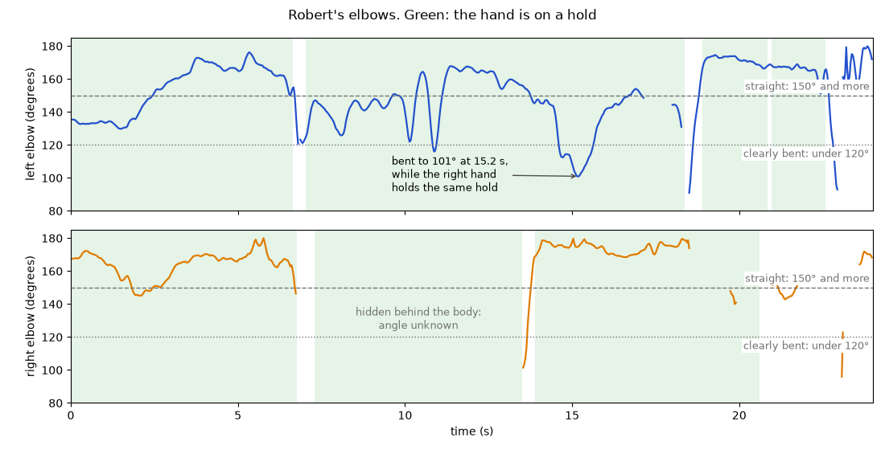
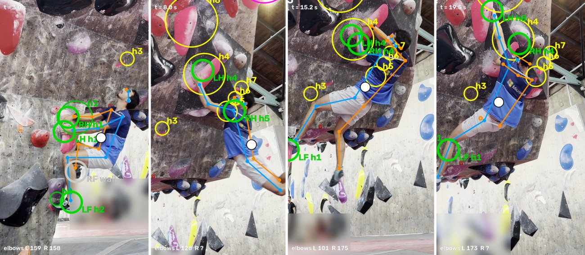
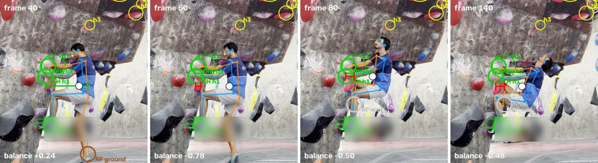
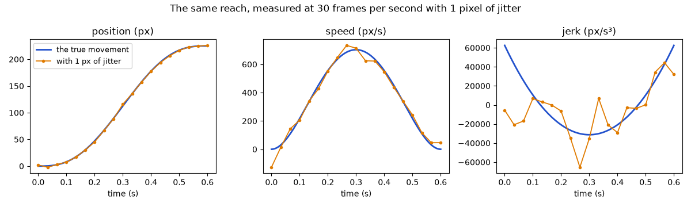

In [part 3](/posts/climbvla-part-3-when-is-a-hand-on-a-hold/), the computer
learned which hand or foot is on which hold, and when, and turned those
touches into moves. Now comes the part a coach would care about: **how** did
the climber move?

Coaches say things like "hang on straight arms", "don't stay locked off",
"keep your balance", "climb smoothly", "don't hesitate". Each of those has to
become a number computed from a skeleton. Some of them translated nicely, one
looked right and was wrong, and one drowned in noise. As before, no machine
learning background is needed.

## Straight arms and lock-offs

An arm is three points: shoulder, elbow, wrist. The angle at the elbow is
180° when the arm is straight. Angles are nice to start with: they need no
scale, so it doesn't matter how far the climber is from the camera.

- **Straight-arm ratio**: of the time a hand is on a hold, the share with the
  elbow open at least 150°. Hanging on straight arms lets the skeleton hold the
  weight instead of the biceps.
- **Lock-off time**: the time a hand holds a hold with the elbow bent under
  120° *while the other hand is off the holds*, so that one bent arm holds the
  whole body. A bent arm while both hands are on is already counted by the
  first number.

I chose the thresholds by looking first: on Robert's climb, elbows on holds
ranged from 120° to 174°, and arms that look straight on the video read 165°
to 178°.

There's a catch with angles in a flat image. My first worry was that an arm
pointing at the camera would look bent. It's the other way around: **a straight
arm always looks straight**, whatever its direction, because a straight line
seen from any angle is still a straight line. It's a *bent* arm that can look
more open, or more bent, than it is. And when the forearm or upper arm points
at the camera, it looks short and its angle means little. So an angle is left
unknown when a segment looks shorter than 60% of its usual length (it is then
pointing at least 53° toward the camera). That removed 4 to 9% of the frames.

<figure>
  
  <figcaption>Robert's elbows over the climb. Green: the hand is on a hold. The right arm is hidden from 7 to 13.5 s, so its angle is unknown there.</figcaption>
</figure>

Results: straight arms 68% of the time, and **lock-off time 0 seconds**. I
checked that zero: each time one hand reached for a hold, the other arm was
straight (156° to 174°). The one deep bend, the left arm at 101° around 15 s,
happens while the right hand is on the same hold. Robert reaches with straight
arms, and a metric that says 0 is allowed to be right.

## The center of mass, and hesitation

Many coaching ideas are about the body as a whole, so I needed its **center of
mass**: the average position of the body, where each part counts by its weight.
Biomechanics has tables for that. In the one I used (Winter's), the trunk is
about half the body, each thigh 10%, and a forearm with its hand only 2.2%.

That last number solves a problem from part 2: the right wrist is often hidden.
When a limb's end is unknown, its weight is placed at its last known joint.
Since a forearm is so light, even a bad guess barely moves the center of mass:
on average, 2.4% of the body's weight was placed by a guess.

<figure>
  
  <figcaption>The white dot is the center of mass. At 15.2 s the left arm is bent to 101° while both hands share a hold. "R ?": the right arm is hidden.</figcaption>
</figure>

With the center of mass, two more metrics:

- **Path**: how far the center of mass travels during a move, and that length
  divided by the straight line from start to end (1 means no detour).
- **Hesitation**: the time the body stays still just before a hand or foot
  leaves for a move. On Robert's climb: 6.9 seconds in total, 2.3 of them
  standing on the start holds before the first hand move.

Each move is measured over its *phase*: from the last time anything landed or
let go (when the body was last settled) until the move lands. A hand move
alone lasts 0.1 to 0.5 seconds, too short to say much; the phase also holds the
preparation, where hesitating happens.

## The balance metric that was right on paper

Balance was next. Coaches want the body over the supports, not swinging out
to the side. So I measured how far the center of mass was, sideways, inside
the span of the holds being used: from the leftmost hand or foot in contact to
the rightmost. Positive inside, negative outside.

The definition was sound. I drew it on the video as a bar between the
supports, with a number in the corner, and it was wrong almost everywhere.

<figure>
  
  <figcaption>The climber hardly moves, yet "balance" jumps from +0.24 to −0.78 when his right foot leaves the ground. The bar sits at the wall and never reaches the white dot.</figcaption>
</figure>

"Sideways", in an image, can only mean left-right in the picture. But this
video films the start wall **from the side**: there, left-right in the picture
is mostly the distance from the wall, not sideways at all. And it films the
overhang **from below**, where left-right mixes "along the roof" and "away
from it". So the number followed whichever foot happened to be furthest
right: +0.24 with the right foot on the ground, −0.78 the moment it lifted,
−0.50 when it touched the wall, while the body barely moved.

I had actually seen the side-view problem on one frame, written it down as a
"known limit", and moved on. It was only when I watched frames 50 to 207 one by
one that it was obvious the number measured nothing. A documented limit is not
the same as a working metric. Balance is now postponed to the step that turns
pixels into wall coordinates, and even there it will need a camera facing the
wall, because the center of mass sits in the body, off the wall.

## Smoothness: why jerk drowned

"Climb smoothly" has a classic answer in movement science: **jerk**. Position
changes over time; its rate of change is the speed, the rate of change of speed
is the acceleration, and the rate of change of acceleration is the jerk. Smooth
human movements keep jerk low: a single smooth reach has a bell-shaped speed
curve. A smoothness score adds up the squared jerk over a move, scaled so big
and small, fast and slow moves compare.

It didn't work, and the reason is worth knowing. Each of those "rates of
change" is computed from the difference between two frames, divided by the time
between them, 1/30 of a second. So each one multiplies the pose's small jitter
by about 30. The speed gets 30 times the jitter, the acceleration 900 times,
the jerk about 27,000 times.

<figure>
  
  <figcaption>One pixel of jitter is invisible in the position, small in the speed, and takes over the jerk.</figcaption>
</figure>

On Robert's climb, changing only the smoothing setting changed the jerk score
by 1 to 2 units, as much as the difference between moves. On the shortest moves
it even scored better than a perfectly smooth reach, which only means the
number measured nothing there.

The fix comes from the same research field: **SPARC**, the spectral arc length.
Instead of differentiating three times, it looks at the speed curve's
*frequencies*: how much slow wobble and fast wobble it contains. One smooth push
has a simple spectrum; a stop-and-go movement, with several pushes, has a bumpy
one. SPARC measures how long and winding that spectrum's curve is, so a single
smooth push scores about −1.4 and two pushes about −2.3. It works on the speed
(30 times the jitter, not 27,000), and the jitter, small and fast, falls mostly
outside the part of the spectrum it looks at.

Changing the smoothing setting now moved SPARC by at most 0.1. On the climb,
the least smooth move was the right foot searching for 4 seconds before finding
the wall (−2.8), and the smoothest the left hand's reach to `h8` (−1.7).

This will matter later: the climber will be compared with a simulated one,
which has no jitter. A jerk score would have made every real climber look
jerkier than the simulation, whatever they did.

## One command

Last, the pieces from the four posts became one command:

```bash
uv run climbvla climb.mp4
```

It runs the pose models (the slow part: 3.5 minutes for this 24-second
video), asks for the holds to be clicked if they aren't yet, then finds the
contacts, moves and metrics and writes a video with everything drawn on it.
The pose is saved and reused, so a second run takes 10 seconds; everything
after it is fast and always recomputed, so it can never be out of date. It
also refuses to mix files from different videos, which would otherwise give
contacts that look plausible and are wrong.

<figure>
<svg viewBox="0 0 750 600" role="img" aria-label="What uv run climbvla climb.mp4 runs, top to bottom: 1. pose, saved and reused when up to date; 2. holds, clicked by hand once and reused; a check that the video, pose and holds have the same image size; 3. contacts and moves; 4. metrics; 5. overlay video. Steps 3 to 5 run again every time. Each step writes a file next to the video." style="width:100%;height:auto;font-family:Inter,system-ui,sans-serif">
  <defs>
    <marker id="p4-arrow" viewBox="0 0 8 8" refX="7" refY="4" markerWidth="7" markerHeight="7" orient="auto">
      <path d="M0,0 L8,4 L0,8 z" style="fill:var(--muted)"/>
    </marker>
  </defs>
  <!-- input -->
  <rect x="110" y="8" width="200" height="40" rx="10" style="fill:var(--surface);stroke:var(--text);stroke-width:1.5"/>
  <text x="210" y="33" text-anchor="middle" style="fill:var(--text);font-size:14px;font-weight:600;font-family:ui-monospace,Menlo,monospace">climb.mp4</text>
  <!-- step boxes -->
  <rect x="20" y="70" width="380" height="60" rx="10" style="fill:var(--accent-soft);stroke:var(--accent);stroke-width:2"/>
  <rect x="20" y="150" width="380" height="60" rx="10" style="fill:var(--surface);stroke:var(--accent-2);stroke-width:2"/>
  <rect x="60" y="232" width="300" height="44" rx="10" style="fill:var(--surface);stroke:var(--muted);stroke-width:1.5;stroke-dasharray:6 5"/>
  <g style="fill:var(--surface);stroke:var(--muted);stroke-width:1.5">
    <rect x="20" y="298" width="380" height="60" rx="10"/>
    <rect x="20" y="378" width="380" height="60" rx="10"/>
    <rect x="20" y="458" width="380" height="60" rx="10"/>
  </g>
  <!-- arrows down -->
  <g style="stroke:var(--muted);stroke-width:1.5" marker-end="url(#p4-arrow)">
    <line x1="210" y1="48" x2="210" y2="68" marker-end="url(#p4-arrow)"/>
    <line x1="210" y1="130" x2="210" y2="148" marker-end="url(#p4-arrow)"/>
    <line x1="210" y1="210" x2="210" y2="230" marker-end="url(#p4-arrow)"/>
    <line x1="210" y1="276" x2="210" y2="296" marker-end="url(#p4-arrow)"/>
    <line x1="210" y1="358" x2="210" y2="376" marker-end="url(#p4-arrow)"/>
    <line x1="210" y1="438" x2="210" y2="456" marker-end="url(#p4-arrow)"/>
  </g>
  <!-- step titles -->
  <g style="fill:var(--text);font-size:15px;font-weight:600">
    <text x="38" y="96">1. Pose</text>
    <text x="38" y="176">2. Holds</text>
    <text x="38" y="324">3. Contacts and moves</text>
    <text x="38" y="404">4. Metrics</text>
    <text x="38" y="484">5. Overlay video</text>
  </g>
  <text x="210" y="259" text-anchor="middle" style="fill:var(--text);font-size:13px;font-weight:600">Same image size: video, pose, holds?</text>
  <g style="fill:var(--muted);font-size:12px">
    <text x="38" y="116">RT-DETR + RTMPose-x on every frame · about 3.5 min</text>
    <text x="38" y="196">clicked by hand in a window, once per video</text>
    <text x="38" y="344">clean the pose → contacts → moves · milliseconds</text>
    <text x="38" y="424">angles, center of mass, hesitation, SPARC</text>
    <text x="38" y="504">everything drawn on the video · a few seconds</text>
  </g>
  <!-- files written -->
  <g style="stroke:var(--muted);stroke-width:1;stroke-dasharray:3 4">
    <line x1="400" y1="100" x2="432" y2="100"/>
    <line x1="400" y1="180" x2="432" y2="180"/>
    <line x1="360" y1="254" x2="432" y2="254"/>
    <line x1="400" y1="328" x2="432" y2="328"/>
    <line x1="400" y1="408" x2="432" y2="408"/>
    <line x1="400" y1="488" x2="432" y2="488"/>
  </g>
  <g style="fill:var(--text);font-size:12.5px;font-family:ui-monospace,Menlo,monospace">
    <text x="440" y="96">climb_pose.npz</text>
    <text x="440" y="176">climb_route.json + .png</text>
    <text x="440" y="324">climb_contacts.json + .png</text>
    <text x="440" y="404">climb_metrics.json</text>
    <text x="440" y="484">climb_metrics.mp4</text>
  </g>
  <g style="fill:var(--muted);font-size:11.5px">
    <text x="440" y="116">reused if newer than the video and</text>
    <text x="440" y="130">made by the same models</text>
    <text x="440" y="196">reused if it exists</text>
    <text x="440" y="258">if not: stop with an error</text>
    <text x="440" y="344">timeline of the contacts</text>
    <text x="440" y="424">per move and for the whole climb</text>
    <text x="440" y="504">the video below</text>
  </g>
  <!-- legend -->
  <rect x="20" y="542" width="14" height="14" rx="3" style="fill:var(--accent-soft);stroke:var(--accent);stroke-width:2"/>
  <rect x="250" y="542" width="14" height="14" rx="3" style="fill:var(--surface);stroke:var(--accent-2);stroke-width:2"/>
  <rect x="500" y="542" width="14" height="14" rx="3" style="fill:var(--surface);stroke:var(--muted);stroke-width:1.5"/>
  <g style="fill:var(--muted);font-size:12px">
    <text x="42" y="554">slow: saved, then reused</text>
    <text x="272" y="554">by hand: saved, then reused</text>
    <text x="522" y="554">fast: run again every time</text>
    <text x="375" y="588" text-anchor="middle">Robert's 24-second video: 3 min 27 s the first time, 10 s after that</text>
  </g>
</svg>
<figcaption>What <code>uv run climbvla climb.mp4</code> runs, top to bottom, and the file each step writes next to the video.</figcaption>
</figure>

## What the video shows

Here is the video the command writes, for Robert's climb (half size; the
people in the background are blurred):

<video src="/assets/posts/climbvla-part-4/overlay.mp4" poster="/assets/posts/climbvla-part-4/overlay-poster.jpg" controls muted playsinline loop></video>

How to read it:

- **Holds**: the circles I clicked. Green are the start holds, magenta the top
  hold, yellow the others, each with its name (`h1` to `h11`).
- **Skeleton**: blue is the climber's left side, orange the right. A hollow dot
  is a point filled in by the cleaning step; a missing limb is one the model
  couldn't see.
- **Contacts**: a thick ring with a label such as `LH h4` (left hand on hold
  `h4`) wherever a hand or foot is resting: green on a hold, grey on the wall,
  brown on the ground.
- **The white dot**: the center of mass.
- **Top-left corner**: the time, then what each hand and foot is doing (`h4`
  when on a hold, `h5 -> h4` during a move, `regrip` when it lets go and comes
  back, `-` when free), then the two elbow angles (`?` when the arm is hidden).

Moments worth watching:

- **0 to 1.6 s**: the right foot is still on the ground (`RF ground`), then
  steps onto the wall.
- **6.7 s**: the jump. Both hands leave `h1` for `h4` and `h5`, and the feet
  swing free for about two seconds.
- **7 to 13.5 s**: the right hand is on `h5` but hidden behind the body: the
  corner says `RH h5` while its elbow reads `?`. This is the hand the model saw
  but didn't believe, from part 3.
- **13.5 s**: the right hand moves from `h5` to `h4`, next to the left hand
  (a "match"). Around **15 s** the left elbow bends to 101° while both hands
  share the hold.
- **18.4 s**: the left hand reaches `h8`, with the right arm straight.
- **After 21 s**: Robert climbs back down and drops off; the top hold `h11` is
  never reached.

## What I learned

1. **Start with the measurement that needs no scale.** Angles worked on day
   one; distances needed a body unit, and "sideways" needed a wall.
2. **Check your intuitions about images.** A straight arm can't look bent; a
   bent one can look straight.
3. **A zero can be a result.** Lock-off time 0 s was true, and checking why
   said something about how Robert climbs.
4. **A documented limit is not a working metric.** The balance number was
   explained in a comment and wrong on almost every frame.
5. **Every derivative multiplies the noise.** Before using a third derivative,
   ask how big the jitter is and what it becomes.

The honest limits: one video, one climber, and thresholds chosen on it.

## What's next

Everything so far has been checked by eye. Next, I label the contacts by hand
and measure how often the computer agrees. That will also say whether feet need
a better pose model, and whether those short "moves" from part 3 are real.

The code is on [GitHub](https://github.com/RomaneCastel/ClimbVLA).
